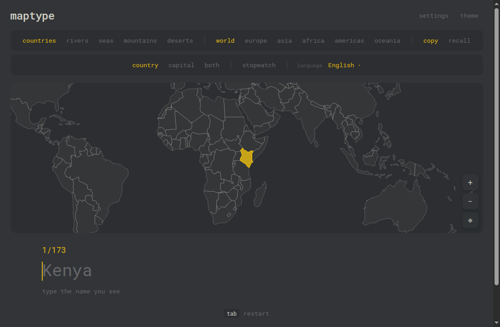

# maptype

Learn the geography of the world by typing it.

**Live site: https://vexut.github.io/maptype/**



maptype shows a place on the map and you type its name. It is a small static web app: no accounts, no tracking, no build step.

## Features

- **Five topics, in any combination:** countries (with capitals), rivers, seas and oceans, mountain ranges, and deserts.
- **Many languages:** country names and capitals follow the language you pick, with a searchable language menu. Where a translation is not available the English name is used, and English is always accepted as an answer.
- **Two modes:** *practice* (the faint answer appears once you type the first letter; wrong letters turn red) and *test* (type from memory, press Enter once for a hint and again to give up).
- **Stopwatch:** an optional running clock with your total time and personal best for each setup.
- **Fine-grained settings:** pick exactly which countries, rivers, seas, mountains and deserts you are asked about, plus questions per round, order and camera speed.
- **Smart camera:** the map flies to each question and chooses how much of the surroundings to show based on the size of the place and how crowded the area is. You can also zoom and pan by hand (mouse wheel, drag, pinch, or the on-map buttons).
- **Mobile friendly:** compact layout, touch gestures that keep the keyboard open, and a cropped map that stays readable on small screens.
- **Themes:** twelve colour themes, including Catppuccin.
- **Private by design:** no cookies, analytics or third-party requests. Settings and best times are kept in the browser's local storage only.

## Run it locally

There is nothing to install or build. Serve the folder with any static file server:

```sh
python3 -m http.server 8000
# then open http://localhost:8000
```

Opening `index.html` directly from disk also works in most browsers.

## Project structure

```
index.html                  the page
404.html                    page shown for unknown links
favicon.svg                 tab icon
robots.txt                  crawler rules
LICENSE                     copyright notice
third-party-notices.txt     licences for map data, names and the font
assets/css/style.css        styling and themes
assets/js/app.js            game logic, camera, settings and themes
assets/js/data.js           country shapes, names and capitals (generated)
assets/js/physical.js       rivers, seas, mountains and deserts (generated)
assets/js/capitals.js       translated capital names (generated)
assets/js/iso.js            country codes used for name translation (generated)
assets/fonts/               Roboto Mono
docs/screenshot.png         screenshot used in this readme
```

The `data.js`, `physical.js`, `capitals.js` and `iso.js` files are generated from the sources below and committed as they are.

## Deployment

The site is hosted on GitHub Pages straight from the `main` branch, so every push to `main` is published automatically. It also works on any other static host (Cloudflare Pages, Netlify and similar): upload the folder so that `index.html` is at the top level.

Asset URLs in `index.html` carry a `?v=` tag. Change it when you edit the CSS or JavaScript so visitors never get an old script paired with a newer page.

## Customising

- **Contact email** in the privacy section: set `CONTACT` near the top of `assets/js/app.js`.
- **Themes:** the `THEMES` list in `assets/js/app.js`.
- **Languages:** the `LANGS` list in `assets/js/app.js`.
- **Camera feel:** the constants at the top of `zoomTo()` in `assets/js/app.js` (`MAX_K`, `CROWD_OK` and the flight timing).
- **A wrong name or capital:** search for it in `assets/js/data.js` or `assets/js/physical.js` and fix the text.

## Data sources and credits

| Data | Source | Licence |
| --- | --- | --- |
| Country shapes | [Natural Earth](https://www.naturalearthdata.com/) via [world-atlas](https://github.com/topojson/world-atlas) | Public domain / ISC |
| Rivers, seas, mountains, deserts | [Natural Earth](https://www.naturalearthdata.com/) | Public domain |
| Translated capital names | [Wikidata](https://www.wikidata.org/) | CC0 |
| Country names in other languages | The browser's built-in `Intl.DisplayNames` | n/a |
| Font | Roboto Mono | SIL Open Font License 1.1 |

Borders and shapes are simplified for learning and take no position on disputed borders or territories. Names are checked carefully but mistakes can happen. If you find one, please open an issue.

Full licence texts are in [`third-party-notices.txt`](third-party-notices.txt).

## Copyright

Copyright (c) 2026 Vexut. All rights reserved. The code and design may not be copied, hosted elsewhere or used commercially without written permission; see [`LICENSE`](LICENSE). Third-party data and fonts keep their own licences (see [`third-party-notices.txt`](third-party-notices.txt)).

Built by [Vexut](https://github.com/Vexut).
